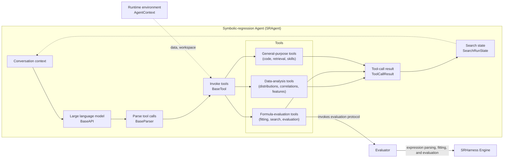
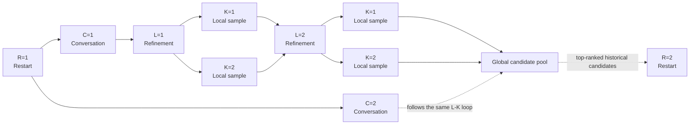
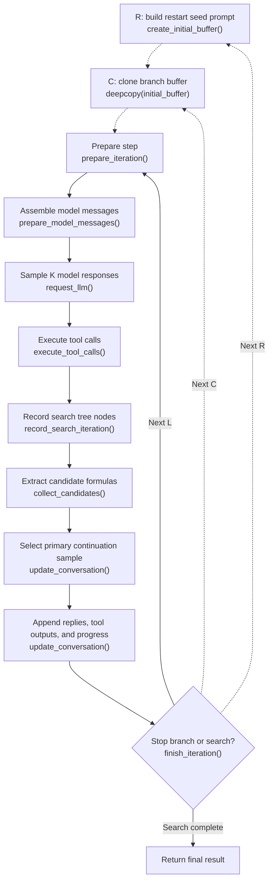

# SRHarness Agent Workflow

This page explains how `SRAgent`—the core symbolic-regression Agent in SRHarness—coordinates language models, scientific tools, and search-tree state in a closed loop.

## 1. Architecture and Component Roles

Language models are good at interpreting domain context, spotting patterns, and proposing structural hypotheses, but they are unreliable at mental arithmetic or nonlinear parameter optimization. SRHarness offloads statistical diagnostics, constant fitting, symbolic search, and formula evaluation into dedicated tools, while the runtime connects the model and tools in a structured loop:

How each component fits into the loop:

- **`SRAgent`**: Orchestrates the search loop—maintaining conversation history, querying the model, dispatching tool calls, and feeding updated search state (such as top candidates and remaining budget) into subsequent turns.
- **`BaseAPI`**: Unified LLM client layer that normalizes requests, streaming responses, token accounting, and retries across providers (OpenRouter, DeepSeek, OpenAI, Gemini, etc.).
- **[`BaseParser`](core-abstractions.md#tool-call-parser)**: Converts provider-specific tool calls (native function calling, JSON, XML, or plain text) into uniform `ToolCall` objects.
- **[`BaseTool`](core-abstractions.md#base-tool)**: Base class for all executable tools, grouped into three categories:
  1. **Data-analysis tools** for inspecting distributions, correlations, and variable relationships;
  2. **Formula-evaluation tools** for fitting constants, running PySR/SINDy searches, scoring candidate expressions, and analyzing residuals;
  3. **General-purpose tools** for running sandboxed Python code, fetching web/PDF references, and loading domain skills.
- **`AgentContext`**: Holds the active dataset (`context.data`), target variable, Evaluator instance, runtime arguments, and workspace paths so the model does not have to pass them on every tool call.
- **`ToolCallResult`**: Standard wrapper returned by every tool call, carrying both the full structured dictionary (`result`) and a concise, length-bounded text summary (`result_str`) for the model.
- **`SearchRunState`**: Records every search node, parent link, and evaluated candidate formula across the run, maintaining the global Pareto front and Top-k leaderboard.
- **[Evaluator](evaluator.md)**: Shared evaluation protocol responsible for train/validation splitting, parameter fitting, and metric calculation.
- **[SRHarness Engine](engine.md)**: Underlying symbolic math engine providing safe expression parsing, parameter optimization, and numerical evaluation.

## 2. R-C-L-K Search Coordinates { #r-c-l-k-search }

To balance deep iterative refinement with broad exploration, SRHarness organizes search trajectories around a four-dimensional **R-C-L-K** coordinate system. Every model response corresponds to a unique `(R, C, L, K)` node in the search tree:

| Dimension | Parameter | Role |
|---|---|---|
| **R** (Restart) | `max_restart_loop` | **Restart loops**. Each new restart seeds its initial prompt with up to `restart_top_k` top-ranked formulas from the global candidate pool so the Agent can build on prior discoveries. |
| **C** (Conversation) | `global_width` | **Parallel branches per restart**. All C branches in a restart start from the same seed prompt but maintain separate conversation histories to explore distinct hypotheses. |
| **L** (Refinement Depth) | `max_refinement_depth` | **Maximum steps per branch**. Along a branch, the Agent iteratively refines formulas using tool feedback. |
| **K** (Local Sample) | `local_sample_size` | **Samples per step**. At each step L, the runtime requests K model responses, executes all of their tool calls, and picks the best-performing sample to continue the branch. |

Without early stopping, a run makes at most `R × C × L × K` model requests.

- Setting `R=1, C=1, K=1` produces a simple single-thread conversation;
- On a fixed budget, spreading budget across restarts (`R`), parallel branches (`C`), or local samples (`K`) usually outperforms spending the entire budget on a single deep `L` trajectory.

`SearchRunState` aggregates evaluated candidates across every `(R, C, L, K)` node to maintain a single global Pareto front and best formula.

## 3. Single-Step Execution Flow

Within each conversation branch, every refinement step `L` runs through the following stages:

Step by step:

1. **`create_initial_buffer()`**: At the start of each restart `R`, builds the seed prompt from the system prompt, task description, and the best historical candidates found so far.
2. **`deepcopy(initial_buffer)`**: At the start of each branch `C`, clones the seed prompt so parallel branches evolve independently.
3. **`prepare_iteration()`**: Applies pending runtime actions before the turn (pausing, applying updated settings, or injecting queued user messages).
4. **`prepare_model_messages()`**: Builds the message list for the model and, at `L=1`, optionally runs initial statistical and relationship diagnostics (`force_initial_diagnostics`).
5. **`request_llm()`**: Requests `K` responses from the language model.
6. **`execute_tool_calls()`**: Runs all tool calls emitted across the `K` responses (in parallel when `max_workers > 0`).
7. **`record_search_iteration()`**: Adds the `K` responses and their `ToolCallResult` objects to the search tree.
8. **`collect_candidates()`**: Extracts valid candidate formulas to update the global leaderboard and Pareto front.
9. **`update_conversation()`**: Chooses the `K` sample with the best candidate score as the main continuation for the next turn, while also folding in useful outputs from data-analysis or general-purpose tools called by sibling samples.
10. **`finish_iteration()`**: Checks whether the current branch or the entire search should pause or stop.

### Stopping Controls in Interactive Search

In the interactive WebUI, an Agent can trigger a pause in two ways:

1. **Explicit `finish_search` tool call**: The Agent explicitly calls `finish_search` when it believes the search is complete;
2. **Tool-free response review**: If the Agent replies with plain text and no tool calls, the backend can send the latest `tool_free_stop_review_rounds` turns (default `1`) to a lightweight tool-free model check to see if the Agent intended to stop (set to `0` to disable).

To prevent premature stopping, both mechanisms must pass the configured **Stop Guard (`stop_guard_mode`)** before the search actually pauses (if the check fails, the reason is fed back to the Agent so it keeps searching):

- **No additional condition (`none`)**: Allow stopping immediately;
- **Unique best result in Top-k (`best_in_topk`)**: Require the top formula in `topk_records` to strictly beat every other distinct formula on the ranking metric;
- **Reach metric threshold (`metric_threshold`)**: Require the best candidate to reach a specified train or validation threshold (e.g., $R^2 \ge 0.999$);
- **Exhaust L budget (`budget_exhausted`)**: Require the current branch to finish all `L` steps before stopping.

## 4. Tool-Call Lifecycle

Every tool call passes through a standardized pipeline so tool declarations, parsing, error handling, and logging behave identically across models and tools:

```mermaid
flowchart LR
    A["Tool declaration<br/>BaseTool subclass"] --> B["Metadata & schema inference<br/>description / parameter schema"]
    B --> C["Format declarations<br/>BaseParser.format_tools()"]
    C --> D[Model response]
    D --> E["Parse tool calls<br/>BaseParser.parse_response()"]
    E --> F["Schedule execution<br/>SRAgent.execute_tool_calls()"]
    F --> G["Execution wrapper<br/>BaseTool.__call__()"]
    G --> H["Tool logic<br/>execute()"]
    H --> I["Text formatting<br/>format_result_dict()"]
    I --> J["Standard result<br/>ToolCallResult"]
    G -. timeout or error wrapped .-> J
    J --> K[Search tree & candidate collection]
    J --> L["Message formatting<br/>BaseParser.format_tool_result_messages()"]
    L --> M[Next-turn model context]
```

1. **Declaration and registration**: Tools subclass `BaseTool` and register under a unique name. Missing descriptions or parameter schemas are inferred automatically from `execute()` type annotations and docstrings.
2. **Exposure**: `SRAgent` instantiates only the tools enabled for the active run, and `BaseParser.format_tools()` formats them for the model API.
3. **Call parsing**: `BaseParser.parse_response()` extracts normalized `ToolCall` objects from native function calls, JSON, XML, or text responses.
4. **Scheduling**: `SRAgent.execute_tool_calls()` dispatches calls to tool instances (supporting concurrent execution across independent calls).
5. **Execution and formatting**: `BaseTool.__call__()` checks cancellation signals, times `execute(**parameters)`, and formats a length-bounded `result_str` via `format_result_dict()`.
6. **Error recovery vs. abort**: Timeouts and ordinary runtime exceptions become `ok=False` `ToolCallResult` objects so the model can see what went wrong and retry, whereas `ToolRunAbort` propagates upward to halt execution.
7. **Result consumption**: The structured `result` dictionary updates the search tree and candidate rankings, while `result_str` is formatted into conversation messages for the next model turn.

See [SRHarness Core Abstractions](core-abstractions.md) for details on implementing custom tools and parsers.
