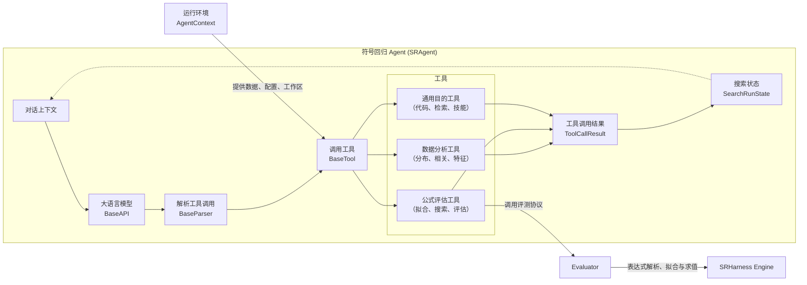
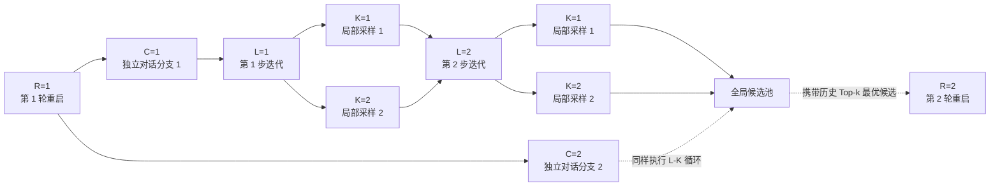
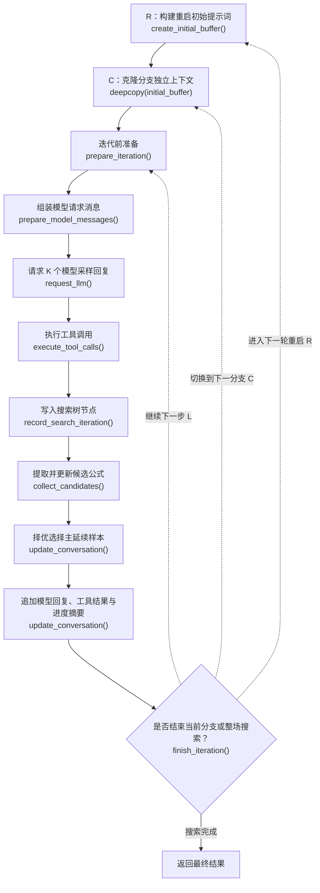

# SRHarness 智能体工作流

本页介绍 SRHarness 的核心智能体 `SRAgent` 是如何把大语言模型、科学计算工具与搜索树状态串联成一个闭环工作流的。

## 1. 核心架构与组件分工

大语言模型擅长理解科学背景、观察趋势并提出直觉假设，但并不擅长直接心算统计量或精确拟合非线性常数。因此，SRHarness 将统计诊断、常数拟合、符号搜索和公式评估剥离为一套标准化工具，由运行时（Runtime）负责在模型与工具之间调度闭环：

图中各核心组件的职责如下：

- **`SRAgent`**：整个搜索循环的控制器。负责维护对话上下文、请求模型、调度工具执行，并将每轮更新后的搜索状态（如当前最优候选公式与剩余预算）注入下一轮提示词。
- **`BaseAPI`**：大模型通信层。屏蔽不同模型服务商（OpenRouter、DeepSeek、OpenAI、Gemini 等）的接口差异，统一处理流式输出、Token 统计与重试。
- **[`BaseParser`](core-abstractions.md#tool-call-parser)**：工具调用解析器。将不同格式（原生 Function Calling、JSON、XML、纯文本）的模型输出统一解析为标准的 `ToolCall` 对象。
- **[`BaseTool`](core-abstractions.md#base-tool)**：工具执行基类。SRHarness 内置了三大类工具：
  1. **数据分析工具**：检查变量统计分布、相关性与非线性关系；
  2. **公式评估工具**：拟合常数、调用 PySR/SINDy 搜索、评估候选表达式并分析残差；
  3. **通用辅助工具**：在安全沙箱中执行 Python 代码、检索文献网页或读取领域技能（Skill）。
- **`AgentContext`**：工具运行环境。统一保管当前数据集（`context.data`）、目标因变量、Evaluator 实例、超参数与工作区路径，无需模型在调用工具时重复传参。
- **`ToolCallResult`**：单次工具调用的标准返回结果，同时包含供程序处理的完整字典（`result`）和供模型阅读的精简文本（`result_str`）。
- **`SearchRunState`**：全局搜索状态树。记录每一次迭代生成的节点、父子关系与评估过的所有候选公式，实时维护全局帕累托前沿（Pareto Front）和 Top-k 榜单。
- **[Evaluator](evaluator.md)**：统一的公式评测协议，负责数据切分、参数拟合与指标打分。
- **[SRHarness 符号引擎](engine.md)**：底层数学引擎，为 Evaluator 提供安全的表达式解析、常数优化与数值求值。

## 2. R-C-L-K 四维搜索树 { #r-c-l-k }

为了兼顾“深度打磨单个思路”与“广度探索不同方向”，SRHarness 采用 **R-C-L-K** 四维坐标来组织整个符号回归搜索过程。模型生成的每一次回复，都唯一对应搜索树中的一个 `(R, C, L, K)` 节点：

四个维度的具体含义如下：

| 维度 | 参数名 | 作用说明 |
|---|---|---|
| **R** (Restart) | `max_restart_loop` | **全局重启次数**。每次开启新的 Restart 时，系统会从全局候选池中挑出至多 `restart_top_k` 个历史最优公式写入新的初始提示词，让 Agent 在前人成果基础上开启新一轮探索。 |
| **C** (Conversation) | `global_width` | **每次重启的并行分支数**。同一个 R 下的多条 C 分支共享相同的初始提示词，但各自维护独立的对话历史，互不干扰地探索不同建模思路。 |
| **L** (Refinement Depth) | `max_refinement_depth` | **单条分支的最大迭代步数**。沿着同一条分支，Agent 根据工具反馈逐轮修正假设、改进公式结构。 |
| **K** (Local Sample) | `local_sample_size` | **每步迭代的局部采样数**。在同一轮 L 中向模型同时采样 K 个回复并全部执行工具，随后择优挑选一个主样本继续下一轮对话。 |

在不触发提前停止的情况下，一次搜索最多请求 `R × C × L × K` 次模型回复。

- 如果设置 `R=1, C=1, K=1`，搜索过程就是一条最简单的单线多轮对话；
- 在总预算固定时，相比于把所有预算都堆在超长的单线深度 `L` 上，适当分配一部分预算给多分支 `C`、重启 `R` 或局部采样 `K`，往往能有效避免模型陷入局部死胡同，取得显著更好的公式发现效果。

无论搜索树如何分叉，`SearchRunState` 都会跨所有分支汇总候选公式，维护全局统一的帕累托前沿与最优解。

## 3. 单步迭代（Refinement Step）执行流程

在每条对话分支中，单步迭代按以下流程顺序推进：

各阶段的具体工作如下：

1. **`create_initial_buffer()`**：在每个 `R` 起点，结合系统提示词、任务描述以及前序 Restart 积累的历史最佳候选公式，生成本轮重启的初始上下文。
2. **`deepcopy(initial_buffer)`**：在每个 `C` 分支起点深拷贝一份初始上下文，让各条分支独立演进。
3. **`prepare_iteration()`**：在每步开始前应用运行期变更（如响应用户的暂停请求、热更新工具与模型配置、接收用户中途插入的指导消息等）。
4. **`prepare_model_messages()`**：构造本轮发给大模型的消息列表；若开启了强制初始诊断（`force_initial_diagnostics`），还会在 `L=1` 时自动附上数据统计与相关性分析结果。
5. **`request_llm()`**：向模型请求 `K` 个采样回复。
6. **`execute_tool_calls()`**：解析并执行回复中的工具调用，生成对应的 `ToolCallResult`（开启 `max_workers > 0` 时，同一批次无依赖的工具调用会并行执行）。
7. **`record_search_iteration()`**：将本轮 `K` 个样本的回复与工具结果作为节点写入搜索树。
8. **`collect_candidates()`**：从工具结果中提取所有合格的候选公式，更新全局排序与帕累托前沿。
9. **`update_conversation()`**：从 `K` 个样本中选出候选公式得分最高的一个作为主分支继续下一轮；同时将其他样本调用数据分析或通用工具得到的新信息一并汇总进来，避免浪费探索成果。
10. **`finish_iteration()`**：在当前轮次结束的安全边界处，检查是否满足提前停止条件或切换下一分支/重启。

### 交互式搜索的停止机制與许可条件

在交互式网页工作台中，搜索可以通过两种方式由 Agent 主动触发暂停：

1. **显式调用 `finish_search` 工具**：Agent 认为已经找到满意公式时主动调用该工具；
2. **无工具回复停机复核**：当 Agent 某轮只输出了总结文本而没有调用任何工具时，系统默认会把最近 `tool_free_stop_review_rounds`（默认为 1）轮对话发给一个独立的轻量请求，判断 Agent 是否打算结束搜索（将该参数设为 `0` 可关闭此自动复核）。

为了防止 Agent 过早“偷懒”停机，你可以在设置中配置**允许停止的条件（Stop Guard）**。只有通过检查时，搜索才会真正暂停；否则系统会把未达标的原因反馈给 Agent，要求它继续探索。可选的停止条件包括：

- **无额外条件**：只要 Agent 请求停止就立即暂停；
- **Top-k 中存在严格最优结果**：当前榜单第一名的公式在排序指标上严格优于其它所有不同公式；
- **达到指标阈值**：当前最优公式在训练集或验证集上的指定指标已达到设定阈值（如 $R^2 \ge 0.999$）；
- **耗尽 L 预算**：必须跑满当前分支设定的最大迭代轮数 `L` 后才允许停止。

## 4. 工具调用的完整生命周期

在 SRHarness 中，模型调用工具并不是简单地直接执行 Python 函数，而是经过一条标准化的执行流水线，从而保证不同模型、不同工具之间的行为与错误处理完全一致：

```mermaid
flowchart LR
    A["工具定义<br/>BaseTool 子类"] --> B["自动补全元数据<br/>说明与 JSON Schema"]
    B --> C["格式化工具声明<br/>BaseParser.format_tools()"]
    C --> D[大模型生成回复]
    D --> E["解析工具调用<br/>BaseParser.parse_response()"]
    E --> F["并发/串行调度<br/>SRAgent.execute_tool_calls()"]
    F --> G["统一执行入口<br/>BaseTool.__call__()"]
    G --> H["具体工具逻辑<br/>execute()"]
    H --> I["文本结果格式化<br/>format_result_dict()"]
    I --> J["标准结果对象<br/>ToolCallResult"]
    G -. 超时或常规异常包装 .-> J
    J --> K[写入搜索树并提取候选公式]
    J --> L["转换为对话消息<br/>BaseParser.format_tool_result_messages()"]
    L --> M[进入下一轮模型上下文]
```

1. **定义与注册**：工具继承 `BaseTool` 并通过稳定名称注册。若未手动编写 JSON Schema，基类会自动从 `execute()` 的类型标注与 docstring 中提取。
2. **按需暴露**：`SRAgent` 仅实例化当前任务勾选的工具，由 `BaseParser.format_tools()` 转换成模型接口所需的声明格式。
3. **解析调用**：`BaseParser.parse_response()` 将模型输出解析为统一的 `ToolCall(name, params, id)` 列表；若模型未调用工具则返回空列表。
4. **调度执行**：`SRAgent.execute_tool_calls()` 找到对应工具实例并传入参数（支持多线程并发执行）。
5. **结果封装**：`BaseTool.__call__()` 检查取消信号、计时执行 `execute()`，并通过 `format_result_dict()` 生成长度受限的 `result_str`，最终打包为 `ToolCallResult`。
6. **容错与中断**：工具内部的超时或运行错误会被捕获并转为 `ok=False` 的正常工具反馈，让模型有机会修正参数重试；而系统级的 `ToolRunAbort` 则直接向上抛出以终止流程。
7. **分流消费**：完整的机器可读字典 `result` 用于记录日志和更新候选公式榜；精简文本 `result_str` 则由 `BaseParser.format_tool_result_messages()` 转为下一轮对话消息发回给模型。

想进一步了解如何自定义工具或解析器，请参阅 [SRHarness 核心抽象](core-abstractions.md)。
