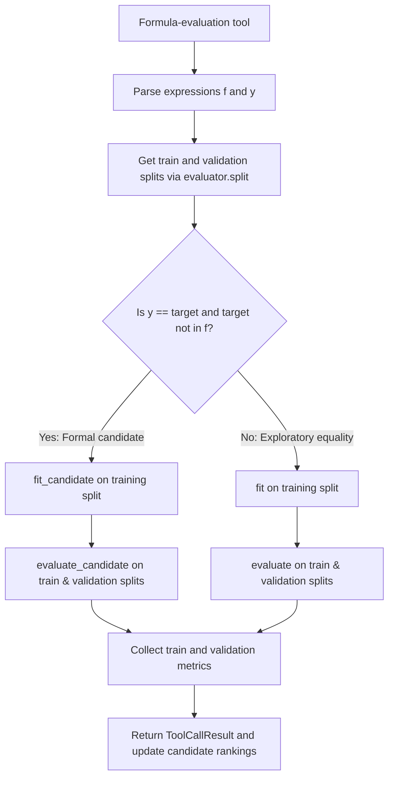

# Formula Evaluation and Custom Evaluators

In SRHarness, an **Evaluator** defines how candidate formulas are scored. It packages **data splitting (`split`)**, **parameter fitting (`fit`)**, and **metric computation (`evaluate`)** into a single protocol shared across `evaluate_formula`, `submit_formula`, polynomial fitting, and external symbolic-search tools.

The active Evaluator instance lives at `AgentContext.evaluator`. SRHarness ships with two built-in Evaluators:

- **`DefaultEvaluator`**: For standard tabular or time-series datasets where samples are aligned along the first dimension;
- **`GraphEvaluator`**: For relational datasets containing node arrays, edge/hyperedge arrays, and graph or hypergraph topology tables.

When your task requires domain-specific scoring—such as integrating a candidate differential equation over time to measure trajectory rollout error—you can subclass `DefaultEvaluator` and override only the methods you need.

!!! info "How Evaluators and SRHarness Engine Work Together"
    Low-level mathematical operations—parsing strings into expression trees, optimizing free constants, and evaluating arrays with NumPy—live in [SRHarness Engine](engine.md). Evaluators sit one level higher: they decide how to split train and validation data, which formulas qualify as formal candidates, and which metrics to compute and rank by.

## 1. How Formula Evaluation Works

When a formula tool (such as `evaluate_formula`) receives a right-hand side `f` and left-hand side `y`, it parses both into [SRHarness Engine](engine.md) `Expression` objects. `BaseTool.evaluate()` then checks whether the equation is a **formal candidate**:

- **Formal candidate**: The left-hand side `y` is exactly the target variable `context.target`, and the right-hand side `f` does not reference `context.target`. Formal candidates run through **`fit_candidate()` → `evaluate_candidate()`** and are recorded in the global Top-k list and Pareto Front.
- **General exploratory equality**: Any other equation (for example, checking an implicit relation between input features) runs through the general **`fit()` → `evaluate()`** path. The Agent still receives full train and validation metrics, but the equation is not added to the candidate leaderboard.



In pseudocode, the evaluation flow looks like this:

```python
def evaluate_formula(f, y, context, evaluator):
    split = evaluator.split(context)
    train_context = split["train"]
    validation_context = split["validation"]
    is_candidate = (
        y.to_str() == context.target
        and context.target not in f.variables
    )

    fitted = (
        evaluator.fit_candidate(f, train_context)
        if is_candidate
        else evaluator.fit(f, y, train_context)
    )
    evaluate = (
        evaluator.evaluate_candidate
        if is_candidate
        else lambda expression, split_context: evaluator.evaluate(
            expression, y, split_context
        )
    )
    return {
        "train": evaluate(fitted, train_context),
        "validation": evaluate(fitted, validation_context),
    }
```

Two important guarantees hold across every evaluation:

1. **No validation leakage**: Free parameters (`param(...)`) are fitted **exclusively on the training split (`train_context`)**. The resulting parameter-bound expression is then evaluated on both the training and validation splits.
2. **Cached data splits**: Accessing `AgentContext.train_split` or `AgentContext.validation_split` calls `evaluator.split(context)` once and caches both split views until the underlying dataset changes or the cache is explicitly cleared.

Residual diagnostics, output formatting, and error handling remain inside `BaseTool`, so custom Evaluators stay focused purely on splitting, fitting, and scoring.

## 2. The `DefaultEvaluator` Interface

`DefaultEvaluator` defines five `@classmethod` entry points that subclasses can override selectively:

| Method | Input `context` | Responsibility |
|---|---|---|
| `split(context)` | Full unsplit `AgentContext` | Split the dataset and return `{"train": AgentContext, "validation": AgentContext}`. |
| `fit(f, y, context)` | Training `AgentContext` | Fit free parameters in `f` to approximate `y` and return an `Expression` with bound parameter values. |
| `evaluate(f, y, context)` | Train or validation `AgentContext` | Evaluate a general equality `y = f` and return a dictionary of numeric metrics. |
| `fit_candidate(f, context)` | Training `AgentContext` | Fit a formal candidate formula (defaults to `fit(f, Symbol(context.target), context)`). |
| `evaluate_candidate(f, context)` | Train or validation `AgentContext` | Evaluate a formal candidate formula (defaults to `evaluate(f, Symbol(context.target), context)`). |

Why separate `fit/evaluate` from `fit_candidate/evaluate_candidate`?
Suppose you are discovering an ODE `dx_dt = f(x, t)`. For formal candidates predicting `dx_dt`, you want `evaluate_candidate()` to numerically integrate `f(x, t)` and compute trajectory rollout error (`rollout_rmse`). At the same time, you still want the Agent to freely test algebraic relationships among features using `evaluate()` without triggering an ODE solver on non-differential equations.

All Evaluators must follow these return-value rules:

- `fit()` and `fit_candidate()` must return an `sr_harness_engine.Expression` with no unbound parameters remaining;
- `evaluate()` and `evaluate_candidate()` must return `dict[str, float | int]` (booleans, strings, arrays, and nested structures are not valid metric values);
- Metric keys returned by the Evaluator appear directly in the train and validation metric dictionaries and can be chosen as the candidate `ranking_metric`;
- `complexity` is returned by the Evaluator just like any other metric rather than injected externally by the runtime.

## 3. Built-in Evaluators

### `DefaultEvaluator`

Assumes sample arrays in `context.data` are aligned along axis 0. It supports both random and out-of-distribution (`ood`) splits, fits parameters via SRHarness Engine, and returns 10 standard metrics out of the box:

```text
mse, rmse, mae, mape, r2,
aic, bic, pearson_r, spearman_r, complexity
```

### `GraphEvaluator`

Subclasses `DefaultEvaluator` for datasets containing node arrays `(..., N)`, edge arrays `(..., E)`, hyperedge arrays `(..., H)`, and graph/hypergraph relation tables. It automatically passes `context.num_nodes` during fitting and evaluation, and slices only sample/time axes during `split()` so shared edge and hyperedge tables stay intact.

## 4. Reusable Evaluator Utilities (`evaluator.utils`)

Common metrics, splitting helpers, and ODE integration routines are available in `sr_harness.evaluator.utils`:

```python
from sr_harness.evaluator import utils
```

Available helpers include:

- **Error metrics**: `calc_MSE()`, `calc_RMSE()`, `calc_MAE()`, `calc_MAPE()`, and `calc_R2()`;
- **Information criteria & correlations**: AIC, BIC, Pearson/Spearman correlation, and expression complexity;
- **Data splitting**: Random, OOD extrapolation, and chronological splits;
- **Dynamics & ODEs**: `integrate_ODE()` and `calc_trajectory_rollout_RMSE()`.

## 5. Writing a Custom Evaluator

The cleanest way to build a custom Evaluator is to subclass `DefaultEvaluator` and override only the specific method you need. For example, `TrajectoryRolloutEvaluator` keeps all default metrics and adds `rollout_rmse` for formal ODE candidates:

```python
from . import utils
from .default_evaluator import DefaultEvaluator


class TrajectoryRolloutEvaluator(DefaultEvaluator):
    @classmethod
    def evaluate_candidate(cls, f, context):
        metrics = super().evaluate_candidate(f, context)
        metrics["rollout_rmse"] = utils.calc_trajectory_rollout_RMSE(
            f,
            context,
            time="t",
            state="x",
        )
        return metrics
```

- Override `fit_candidate()` as well if parameter optimization itself should minimize trajectory rollout error;
- Override `fit()` or `evaluate()` only if both exploratory equalities and formal candidates require custom fitting or scoring.

### Sandboxed Loading and Execution

Each custom Evaluator file must define **exactly one** `DefaultEvaluator` subclass.

`load_custom_evaluator()` validates and loads custom source code inside an isolated child process and returns a lightweight proxy in the main server process. Every subsequent `split`, `fit`, and `evaluate` call executes inside the OS sandbox (Landlock + seccomp) so untrusted user or Agent code never runs directly inside the Web server process.

In the [SRHarness WebUI](web-ui.md#evaluator-configuration), you can edit, save, and test scripts in `context.evaluator/` directly in the browser, or ask the built-in **Evaluator Construction Agent** to write and verify one from a natural-language prompt.

See the [API Reference](https://yuzhthu.github.io/SRHarness/reference/) for complete method signatures and [SRHarness Engine](engine.md) for expression syntax and graph evaluation semantics.
