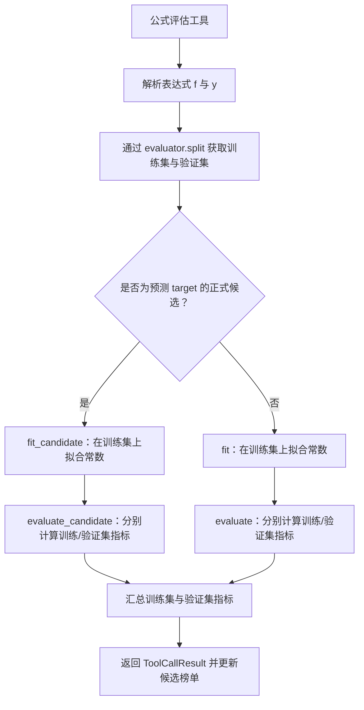

# 公式评估与自定义 Evaluator

在 SRHarness 中，**Evaluator（评估器）** 决定了“如何评价一个数学公式的好坏”。它把**数据切分（Split）**、**待定常数拟合（Fit）**与**误差指标计算（Evaluate）**封装成一套统一的协议，让 `evaluate_formula`、`submit_formula`、多项式拟合以及外部符号搜索工具都遵循完全相同的评分标准。

当前生效的评估器实例保存在 `AgentContext.evaluator` 中。SRHarness 开箱提供两个内置评估器：

- **`DefaultEvaluator`**：适用于各变量沿样本维对齐的常规表格或时间序列数据；
- **`GraphEvaluator`**：适用于包含节点、边、超边及网络拓扑关系的图/超图数据。

如果内置指标不能满足你的科研需求（例如你需要把候选微分方程积分成完整轨迹，再按长期预测误差排序），只需继承 `DefaultEvaluator` 并重写相应方法即可。

!!! info "Evaluator 与符号引擎（SRHarness Engine）如何分工？"
    底层数学工作——把字符串解析成表达式树、用优化器拟合常数、用 NumPy 计算表达式取值——都由 [SRHarness 符号引擎](engine.md) 完成。而 Evaluator 则站在更高一层，负责决定“哪些样本算训练集、哪些算验证集”、“什么公式算正式候选公式”以及“要计算哪些评价指标”。

## 1. 公式评估的完整流程

当 Agent 调用公式评估工具（如 `evaluate_formula`）并传入公式右侧 `f` 与左侧目标 `y` 时，系统会先将文本解析为 [SRHarness 符号引擎](engine.md) 的 `Expression` 对象，然后由 `BaseTool.evaluate()` 判断该公式是否属于**正式候选公式（Candidate）**：

- **正式候选公式**：等式左侧 `y` 恰好是任务设定的因变量 `context.target`，且等式右侧 `f` 中不包含该因变量（即显式预测公式）。此时走专属的 **`fit_candidate()` → `evaluate_candidate()`** 路径，并参与全局 Top-k 与帕累托前沿排序。
- **一般探索等式**：例如 Agent 为了检验两个自变量之间的隐式关系而评估 `x1 + x2 = 0` 或其它中间变量关系。此时走通用的 **`fit()` → `evaluate()`** 路径，仅返回拟合指标供 Agent 参考，不会进入最终候选榜单。



用一段简化的伪代码来表示，核心调用逻辑如下：

```python
def evaluate_formula(f, y, context, evaluator):
    split = evaluator.split(context)
    train_context = split["train"]
    validation_context = split["validation"]
    is_candidate = (
        y.to_str() == context.target
        and context.target not in f.variables
    )

    fitted = (
        evaluator.fit_candidate(f, train_context)
        if is_candidate
        else evaluator.fit(f, y, train_context)
    )
    evaluate = (
        evaluator.evaluate_candidate
        if is_candidate
        else lambda expression, split_context: evaluator.evaluate(
            expression, y, split_context
        )
    )
    return {
        "train": evaluate(fitted, train_context),
        "validation": evaluate(fitted, validation_context),
    }
```

这里有两个关键设计细节：

1. **严格防数据泄露**：所有待拟合参数（`param(...)`）都**只在训练集（`train_context`）上拟合**；拟合完成后，带着固定参数的同一个表达式会分别在训练集和验证集上计算指标。
2. **切分结果自动缓存**：首次访问 `AgentContext.train_split` 或 `AgentContext.validation_split` 时会调用一次 `evaluator.split(context)` 并将切分后的两个视图缓存起来，直到数据集发生更新或缓存被主动清空。

至于残差诊断分析、结果文本格式化以及异常捕获封装，则统一由 `BaseTool` 处理，编写自定义 Evaluator 时无需关心。

## 2. `DefaultEvaluator` 接口规范

`DefaultEvaluator` 定义了 5 个类方法（`@classmethod`），自定义 Evaluator 可以按需重写其中任意几个：

| 方法 | 传入的 `context` | 职责说明 |
|---|---|---|
| `split(context)` | 完整未切分的 `AgentContext` | 将数据切分为训练集与验证集，必须返回 `{"train": AgentContext, "validation": AgentContext}`。 |
| `fit(f, y, context)` | 训练集 `AgentContext` | 拟合 `f` 中的待定参数以逼近 `y`，返回所有参数均已绑定数值的 `Expression`。 |
| `evaluate(f, y, context)` | 训练集或验证集 `AgentContext` | 计算一般等式 `y = f` 的各项数值误差指标，返回指标字典。 |
| `fit_candidate(f, context)` | 训练集 `AgentContext` | 拟合正式候选公式；默认直接调用 `fit(f, Symbol(context.target), context)`。 |
| `evaluate_candidate(f, context)` | 训练集或验证集 `AgentContext` | 评估正式候选公式；默认直接调用 `evaluate(f, Symbol(context.target), context)`。 |

为什么要把 `fit/evaluate` 和 `fit_candidate/evaluate_candidate` 拆开？
举个例子：在微分方程发现任务中，因变量是导数 `dx_dt`。当评估正式候选公式 `dx_dt = f(x, t)` 时，我们希望在 `evaluate_candidate()` 中对 `f(x, t)` 做 ODE 数值积分，计算预测轨迹与真实轨迹的误差（`rollout_rmse`）；但如果 Agent 只是在探索自变量之间的代数关系，显然不应该去跑 ODE 积分。两层接口让你既能为正式候选定制深度评测，又不影响 Agent 自由探索普通等式。

编写自定义 Evaluator 时，请确保返回值满足以下要求：

- `fit()` 与 `fit_candidate()` 必须返回 `sr_harness_engine.Expression` 对象，且其中不能残留未绑定数值的参数；
- `evaluate()` 与 `evaluate_candidate()` 必须返回 `dict[str, float | int]`（指标值只能是浮点数或整数，不能放布尔值、字符串、数组或嵌套字典）；
- 返回字典中的键名会原样出现在训练集和验证集结果中，并且可以直接在设置中选作候选公式排序指标（`ranking_metric`）；
- 公式复杂度 `complexity` 与其他指标一样由 Evaluator 返回（运行时不会在外部硬编码塞入额外指标）。

## 3. 内置评估器一览

### `DefaultEvaluator`

适用于样本沿第一维（第 0 轴）对齐的常规数据。支持随机切分（`random`）和按指定变量排序的外推切分（`ood`），默认计算并返回以下 10 项指标：

```text
mse, rmse, mae, mape, r2,
aic, bic, pearson_r, spearman_r, complexity
```

### `GraphEvaluator`

继承自 `DefaultEvaluator`，专门处理包含节点变量 `(..., N)`、边变量 `(..., E)`、超边变量 `(..., H)` 以及关系表的数据集。它在拟合与求值时会自动传入节点总数 `context.num_nodes`，并在切分训练/验证集时只切分前面的样本/时间维，保持底层的图边表与超边表完整不变。

## 4. 评估辅助工具库（`evaluator.utils`）

为了让你在编写自定义 Evaluator 时不必手写常见指标和积分逻辑，SRHarness 在 `sr_harness.evaluator.utils` 中提供了丰富的现成函数：

```python
from sr_harness.evaluator import utils
```

常用工具函数包括：

- **基础误差指标**：`calc_MSE()`、`calc_RMSE()`、`calc_MAE()`、`calc_MAPE()`、`calc_R2()`；
- **统计与复杂度指标**：AIC、BIC、Pearson / Spearman 相关系数、表达式树复杂度计算；
- **数据切分辅助**：随机切分、OOD 外推切分、按时间/顺序切分；
- **动力学轨迹积分**：`integrate_ODE()` 与 `calc_trajectory_rollout_RMSE()`。

## 5. 编写自定义 Evaluator 示例

扩展 Evaluator 最稳妥的方式是继承 `DefaultEvaluator`，并**只重写需要修改的最小方法**。

例如，下面的 `TrajectoryRolloutEvaluator` 完整保留了默认的随机/OOD 切分、参数拟合与常规逐点误差指标，仅针对正式候选公式额外计算了一项 ODE 轨迹积分误差 `rollout_rmse`：

```python
from . import utils
from .default_evaluator import DefaultEvaluator


class TrajectoryRolloutEvaluator(DefaultEvaluator):
    @classmethod
    def evaluate_candidate(cls, f, context):
        metrics = super().evaluate_candidate(f, context)
        metrics["rollout_rmse"] = utils.calc_trajectory_rollout_RMSE(
            f,
            context,
            time="t",
            state="x",
        )
        return metrics
```

- 如果你还希望参数拟合过程本身直接最小化轨迹误差，可以同时重写 `fit_candidate()`；
- 如果连普通探索等式的拟合或评估方式也需要一并改变，再重写 `fit()` 或 `evaluate()`。

### 安全加载与沙箱隔离

每个自定义 Evaluator 脚本必须定义**且仅定义一个** `DefaultEvaluator` 的子类。

为了保障安全，SRHarness 通过 `load_custom_evaluator()` 在独立受限进程中解析并校验自定义脚本，在主进程中仅保留一个同名代理对象；后续每次调用 `split`、`fit`、`evaluate` 也都在操作系统沙箱（Landlock + seccomp）中隔离执行，绝不会在 Web 服务主进程内直接运行不受信任的自定义代码。

在 [SRHarness 网页工作台](web-ui.md#evaluator-configuration) 中，你可以直接在代码编辑器里编写、保存并一键测试 `context.evaluator/` 下的脚本，也可以直接用自然语言让内置的**评测器构建 Agent** 帮你生成和调试代码。

完整的类与方法签名请查阅 [API Reference](reference/index.md)；关于底层表达式语法与图结构求值规则，请参阅 [SRHarness 符号引擎](engine.md)。
